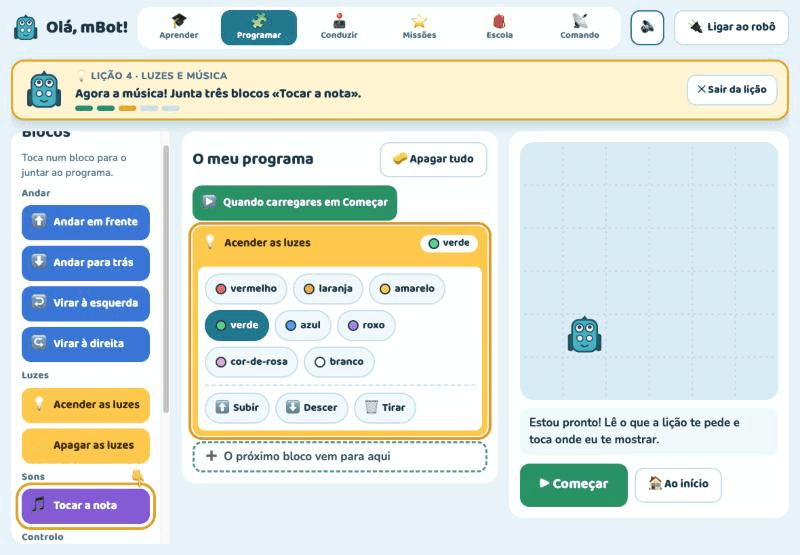
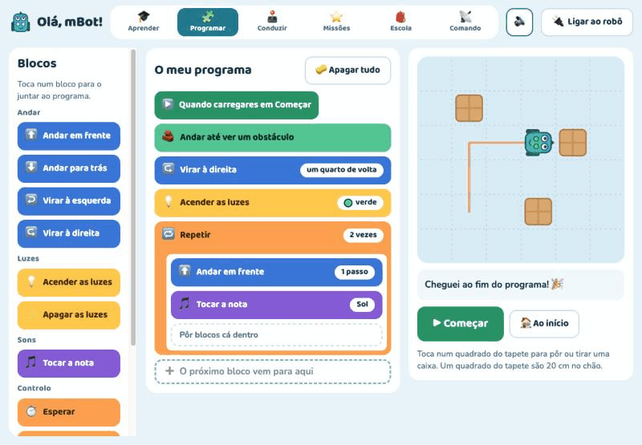
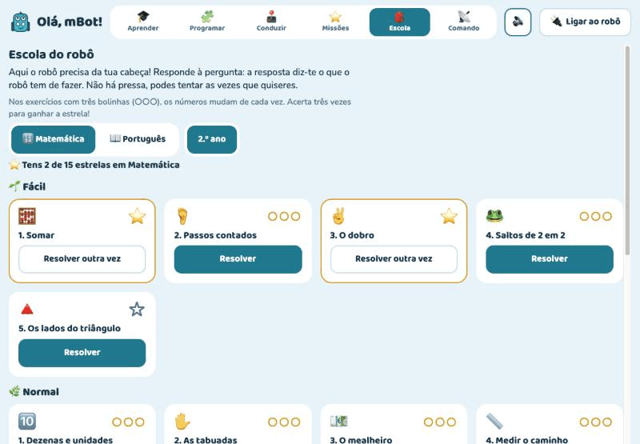

# Olá, mBot!

> [!NOTE]
> **Made with generative AI.** The code, the texts and the school exercises in
> this repository were written with an AI assistant (Claude, by Anthropic),
> directed and tried out by a person. They have not been fully reviewed and may
> contain mistakes. The project is provided as is, without warranty of any kind:
> use it at your own risk, and supervise children while the robot is moving. It
> is a personal project, not affiliated with or endorsed by Makeblock.

A web app in European Portuguese (PT-PT) for an eight-year-old to program a
[Makeblock mBot](https://www.makeblock.com/pages/mbot-robot-kit) with blocks.
It has six tabs:

| Tab | What it is |
| --- | --- |
| **Aprender** | The tutorial: seven short lessons. The robot says what to do and points at what to tap. |
| **Programar** | Tap blocks to build a program, then watch the robot run it on the mat. |
| **Conduzir** | Drive with arrows, let the robot's eyes stop it before it bumps, map the room with a 360° radar turn, switch the lights, play the buzzer like a piano, or tap one of twelve jingles. Its **Explorar** part lets the robot find the way out of the room by itself. |
| **Missões** | Eight gentle challenges with hints and stars. No timers, no failing. |
| **Escola** | Matemática and Português exercises for the 2.º ano, in three levels. The answer tells the robot what to do. Many draw new numbers each time and earn their star after three right answers. |
| **Comando** | The infrared remote that comes in the box, button by button. |

Every command goes to the robot drawn on screen and, when one is connected over
Bluetooth, to the real mBot too. Without a robot the app is fully usable.

## Screenshots

| | |
| --- | --- |
| <br>**Aprender**: the lessons, in order. | <br>A lesson: the coach points at what to tap next. |
| <br>**Programar**: blocks, the program and the mat. | <br>**Conduzir**: arrows, and the radar's view of the mat. |
| <br>**Explorar**: the robot finds the door by itself. | <br>**Missões**: the labyrinth, solved. |
| <br>**Escola**: exercises by subject and level. | <br>An exercise: read, then take the robot to the answer. |
| <br>**Comando**: the remote, button by button. | |

## Run it

No build step and no dependencies: plain HTML, CSS and ES modules.

```bash
python3 -m http.server 8765
```

Then open <http://localhost:8765>. The modules need a web server, so opening
`index.html` straight from the disk does not work.

## Connect a real mBot

The robot must be the Bluetooth version and run the factory firmware (06.01.x),
the one that makes the remote work.

| Device | Browser |
| --- | --- |
| Mac, Windows, Chromebook, Android | Chrome or Edge |
| iPad, iPhone | [Bluefy](https://apps.apple.com/app/id1492822055), a free browser with Web Bluetooth. Safari has none. |

Web Bluetooth only works on `https://` pages (and on `localhost`), so for the
iPad the app is published with GitHub Pages from the `main` branch:
<https://emanuelgoncalves.github.io/ola-mbot/>. Pushing to `main` updates it.

The mBot has no wheel sensors: a step and a quarter turn are timed motor runs.
"Ligar ao robô → Afinar o robô" has two sliders to match them to your floor and
batteries. It also has two switches for a robot that drives or turns the wrong
way, which happens when the two motors were plugged into each other's sockets.

## The mat and the real floor

One square of the mat stands for a square of floor, 20 cm wide unless changed in
"Afinar o robô". One step should cover one square: "Afinar o passo sozinho" lets
the mBot measure its own step against a wall with its ultrasonic sensor and sets
the step time from it. The eyes call something an obstacle when it is less than
one square away, as on screen.

"Conduzir → Mapa da sala" turns the robot once around in short spins. At each
stop it reads the distance 7 times and keeps the average of the middle readings,
so a missed echo or a wild value does not count. Each distance becomes a point
on the mat, and the squares with something in them become boxes. The sensor sees
in a wide cone, so one thing seen by neighbouring looks is counted once
(`distinct` in `js/robot/radar.js`). Without a robot connected, the radar only
draws what the robot on screen sees.

A short spin turns the robot less than its time suggests, because the motors
need a moment to get going, so the number of spins in a full turn has to be
found on the real robot. "Contar as rodadelas sozinho" does it with the sensor:
with one box close in front and nothing else near, the robot spins until it has
lost the box and found it again. After every scan the robot also checks that it
sees again what it saw at first, and says so when the turn was not a full one.
It stays a coarse map: turns are timed, not measured, and the cone is about 30°
wide.

## Finding the way out

"Conduzir → Explorar" makes the robot look for a doorway, 80 cm to 1 m wide, and
drive through it. Its eyes only look ahead and it cannot measure how far it
went, so it uses the one thing it can measure well, the distance to a wall it
faces squarely (`js/robot/explorer.js`):

1. It turns once around and walks to the nearest thing it sees.
2. It follows that wall, keeping it on its right. After every step it turns to
   look at the wall, and steers by how the distance changed.
3. Where the wall is missing it counts the steps. That is a rough width, so any
   opening that is not clearly too small is tried.
4. It goes to the middle of the opening, turns in and stands on the wall's line.
   The distances to the two sides of the frame add up to the true width.
5. If that is a door, it centres itself, drives through, and checks that the
   frame is behind it: a passage that goes on between two walls is a corridor.

A corner or a piece of furniture ahead becomes the wall to follow. The end of a
wall is gone round. After a full lap with no door, it gives up.

A map shows where the robot thinks it is, by dead reckoning, so it bends over
time. Without an mBot connected, the robot on screen explores one of four
pretend rooms (`js/robot/room.js`), whose sonar has a wide cone and gets no echo
from walls seen at a slant. In those rooms the door is found in every test run
with moves and turns up to 4% off, and in most with 8%. On a real floor expect
it to be slow (about three seconds a step) and to fail sometimes: a door left
half open, a rug, or a wide passage will fool it.

## Layout

```
index.html            entry page
artifact.html         the same page as a fragment, for publishing as a Claude Artifact
css/                  tokens (both themes), base, and one file per area
js/main.js            builds the page and switches tabs
js/texts.js           interface text (PT-PT)
js/tutorial.js        the tutorial's lessons, step by step
js/missions.js        the missions and the star board
js/school.js          the school exercises, by subject, year and level
js/jingles.js         short tunes for the buzzer, and their player
js/remote-guide.js    what each remote button does
js/program/           block catalogue, program model, interpreter
js/robot/             protocol, Bluetooth link, real mBot, simulator, hub, radar, explorer and its pretend rooms
js/ui/                one module per tab, plus shared pieces
tests/                browser tests
docs/screenshots/     the pictures in this README
```

A lesson is data: each step has its text, what to point at and a test that
tells when it is done. `js/ui/coach.js` shows the first step that is not done
yet, so a child who undoes something is simply walked through it again.

The interpreter talks to one `RobotHub`, which forwards each command to the
`Simulator` and to the `MBot`. Both implement the same commands: `move`, `turn`,
`rotate`, `moveUntilObstacle`, `setLights`, `playTone`, `obstacleAhead`, `drive`,
`stop`.

A school exercise is a mission with a subject: a question, a mat with signs
(squares holding a number or a word), a `check` on what the robot did, and a
`solution` the tests run. An exercise with `make(random)` draws new numbers for
every round: `make` returns that round's question, mat, check and solution, and
the star comes after `rounds` right answers, each on a different round (the
`MissionBoard` counts them). A wrong answer keeps the same numbers. To add a
school year, add its key next to `2` in `js/school.js` and list it in `YEARS`.

## Tests

With the server running, open <http://localhost:8765/tests/>. The page runs the
protocol, program, interpreter and simulator tests, plays a reference solution
for every mission and school exercise (forty random rounds of each one that
draws numbers), checks that every lesson can be finished,
that the jingles use only the piano's notes, that the radar averages and maps
its readings, and that the explorer finds the door of each pretend room.

## Protocol

Packets follow the factory firmware's parser
([source](https://github.com/Makeblock-official/Makeblock-Libraries/blob/master/examples/Firmware_For_mBlock/mbot_factory_firmware/mbot_factory_firmware.ino)):
`ff 55 <length> <index> <action> <device> <data…>`.

| Command | Bytes |
| --- | --- |
| Both wheels | `ff 55 07 00 02 05 <left int16> <right int16>` (left is mirrored) |
| Both LEDs | `ff 55 09 00 02 08 07 02 00 <r> <g> <b>` |
| Buzzer | `ff 55 07 00 02 22 <hz int16> <ms int16>` |
| Read distance | `ff 55 04 <index> 01 01 03` → `ff 55 <index> 02 <float32> 0d 0a` |

Bluetooth service `ffe1`; write to characteristic `ffe3`, notifications on `ffe2`.

The firmware plays a note with a blocking loop and reads its 64-byte serial
buffer only between commands. Packets that arrive during a note can overflow the
buffer, and a garbled packet can be taken for a very long note, which leaves the
robot beeping and deaf. So `MBot` sends nothing while a note plays, and of the
packets that waited it sends only the newest of each kind.
