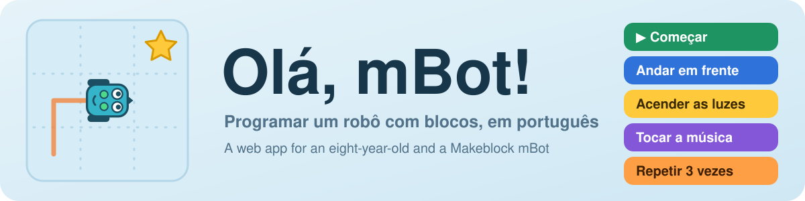
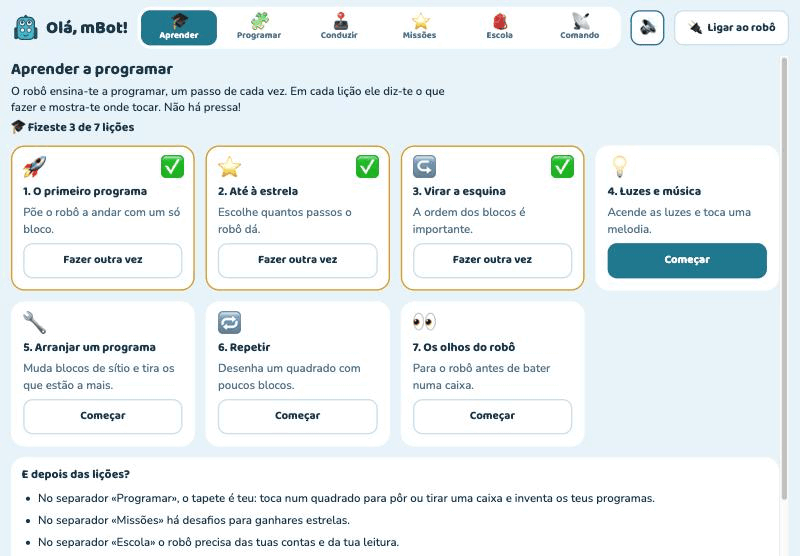
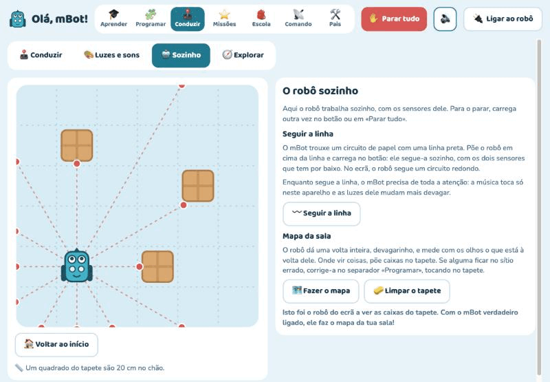
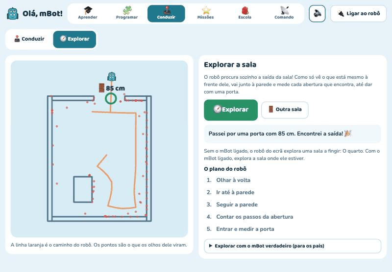
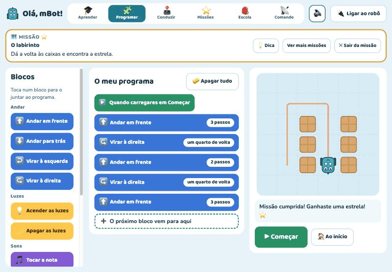
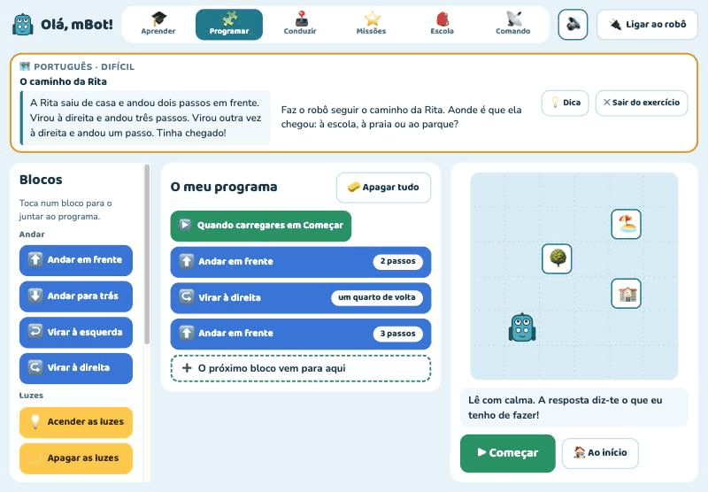
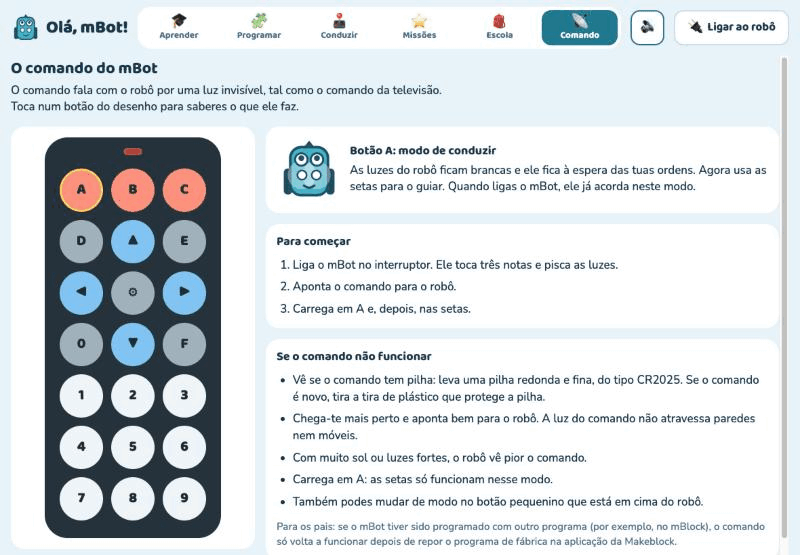
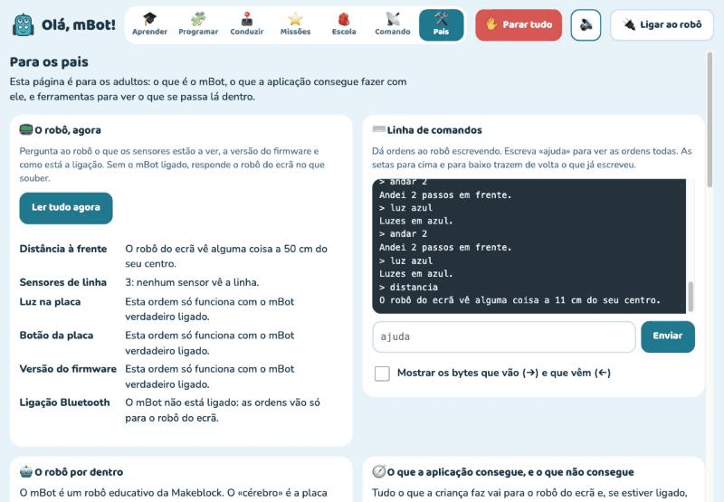

<p align="center">
  
</p>

<p align="center">
  <a href="https://emanuelgoncalves.github.io/ola-mbot/"><b>▶ Open the app</b></a>
  &nbsp;·&nbsp; <a href="#what-it-does">What it does</a>
  &nbsp;·&nbsp; <a href="#screenshots">Screenshots</a>
  &nbsp;·&nbsp; <a href="#connect-a-real-mbot">Connect a robot</a>
  &nbsp;·&nbsp; <a href="#how-it-works">How it works</a>
</p>

<p align="center">
  
  
  
  
  
</p>

A web app in European Portuguese for an eight-year-old to program a
[Makeblock mBot](https://www.makeblock.com/pages/mbot-robot-kit) with blocks.
Every command goes to a robot drawn on screen and, when one is connected over
Bluetooth, to the real mBot too. Without a robot the app is fully usable.

> [!NOTE]
> **Made with generative AI.** The code, the texts and the school exercises in
> this repository were written with an AI assistant (Claude, by Anthropic),
> directed and tried out by a person. They have not been fully reviewed and may
> contain mistakes. The project is provided as is, without warranty of any kind:
> use it at your own risk, and supervise children while the robot is moving. It
> is a personal project, not affiliated with or endorsed by Makeblock.

## What it does

| | Tab | What it is |
| :-: | --- | --- |
| 🎓 | **Aprender** | The tutorial: seven short lessons. The robot says what to do and points at what to tap. |
| 🧩 | **Programar** | Tap blocks to build a program, then watch the robot run it on the mat. Moves, lights and light shows, notes and whole tunes, repeats, and the robot's eyes. |
| 🕹️ | **Conduzir** | Four parts. **Conduzir**: drive with arrows and stop before bumping. **Luzes e sons**: colours, light shows, a piano and tunes. **Sozinho**: the robot follows the black line of the printed circuit, or maps the room. **Explorar**: it finds the way out of the room by itself. |
| ⭐ | **Missões** | Eight gentle challenges with hints and stars. No timers, no failing. |
| 🎒 | **Escola** | Matemática and Português exercises for the 2.º ano, in three levels. The answer tells the robot what to do. Many draw new numbers each time and earn their star after three right answers. |
| 📡 | **Comando** | The infrared remote that comes in the box, button by button. |
| 🛠️ | **Pais** | For grown-ups: what the robot is made of, what the app can and cannot do with it, firmware and batteries, what the sensors read right now, and a command line. |

A red **Parar tudo** button, always in the top bar, ends whatever is running
and resets the robot.

## Screenshots

| | |
| --- | --- |
| <br>**Aprender**: the lessons, in order. | <br>A lesson: the coach points at what to tap next. |
| <br>**Programar**: blocks, the program and the mat. | <br>**Conduzir**: four parts. Here the robot maps what is around it. |
| <br>**Explorar**: the robot finds the door by itself. | <br>**Missões**: the labyrinth, solved. |
| <br>**Escola**: exercises by subject and level. | <br>An exercise: read, then take the robot to the answer. |
| <br>**Comando**: the remote, button by button. | <br>**Pais**: live readings and a command line. |

## Try it

The app is live at <https://emanuelgoncalves.github.io/ola-mbot/>. To run your
own copy there is no build step and nothing to install: plain HTML, CSS and ES
modules.

```bash
python3 -m http.server 8765
```

Then open <http://localhost:8765>. The modules need a web server, so opening
`index.html` straight from the disk does not work.

## Connect a real mBot

The robot must be the Bluetooth version and run the factory firmware (06.01.x),
the one that makes the remote work.

| Device | Browser |
| --- | --- |
| Mac, Windows, Chromebook, Android | Chrome or Edge |
| iPad, iPhone | [Bluefy](https://apps.apple.com/app/id1492822055), a free browser with Web Bluetooth. Safari has none. |

Web Bluetooth only works on `https://` pages (and on `localhost`), so for the
iPad the app is published with GitHub Pages from the `main` branch. Pushing to
`main` updates it.

The mBot has no wheel sensors and no gyroscope: a step and a quarter turn are
timed motor runs, which change with the floor and the batteries. "Ligar ao robô
→ Afinar o robô" has sliders for them, and the robot can set them by itself with
its distance sensor:

- **Afinar o passo sozinho**: facing a flat wall about a metre away, it takes one
  step forward and one back, measures both with its eyes, and sets the step time.
  A reading where the two steps disagree is thrown away.
- **Afinar as voltas sozinho**: with things around it at different distances, it
  turns in short spins for almost two turns and finds how many spins a turn
  takes from where the view repeats. From that it sets the radar's spin to a
  twelfth of a turn. Then it makes four quarter turns, sees where it ended, and
  corrects the quarter-turn time, twice over. It takes about a minute and a half.

The times the app starts with were measured this way on a real mBot: 1.26 s for a
20 cm step, 0.46 s for a quarter turn. Batteries and the floor change them, so
run the two buttons again when the robot stops short or turns too far. The robot
on screen never plays slower than a brisk robot when no real one is connected.

The same section has two switches for a robot that drives or turns the wrong
way, which happens when the two motors were plugged into each other's sockets.

## How it works

<details>
<summary><b>The mat and the real floor</b></summary>

One square of the mat stands for a square of floor, 20 cm wide unless changed in
"Afinar o robô". One step should cover one square. The eyes call something an
obstacle when it is less than one square away, as on screen.

"Conduzir → Mapa da sala" turns the robot in short spins. At each stop it reads
the distance 7 times and keeps the average of the middle readings, so a missed
echo or a wild value does not count. Each distance becomes a point on the mat,
and the squares with something in them become boxes. The sensor sees in a wide
cone, so one thing seen by neighbouring looks is counted once (`distinct` in
`js/robot/radar.js`).

A short spin turns the robot less than its time suggests, because the motors
need a moment to get going (about 26 ms on a real mBot), and the robot cannot
measure the angle. So the real robot spins for more than a full turn, and
`spinsInATurn` finds how often the looks repeat: that is one turn, however many
spins it took, and it need not be a whole number. Two turns repeat as well as
one, so a half of the best fit wins when it fits too, and a repeat seen in fewer
than six pairs of looks is not believed. A turn within a quarter of the tuned
one is kept for next time and for exploring. With nothing to recognise around
it, or with somebody walking by, the robot says the map may be off. It stays a
coarse map: the cone is about 30° wide, and a smooth wall seen at a slant sends
no echo back. Without a robot connected, the radar only draws what the robot on
screen sees.

</details>

<details>
<summary><b>Following the line</b></summary>

"Conduzir → Seguir a linha" follows the black line of the paper circuit that
comes in the box, with the two sensors under the robot
(`js/robot/line-follower.js`). On the line it drives straight. With the line
under one sensor only, the wheel on that side slows down. Off the line, it turns
on the spot towards the side it last saw the line on, as the robot's own mode C
does. Over Bluetooth each look takes some tens of milliseconds, so start with
the slow speed. On screen, a round circuit is drawn on the mat for the robot
there to follow.

</details>

<details>
<summary><b>Finding the way out</b></summary>

"Conduzir → Explorar" makes the robot look for a doorway, 80 cm to 1 m wide, and
drive through it. Its eyes only look ahead and it cannot measure how far it
went, so it uses the one thing it can measure well, the distance to a wall it
faces squarely (`js/robot/explorer.js`):

1. It turns once around and walks to the nearest thing it sees.
2. It follows that wall, keeping it on its right. After every step it turns to
   look at the wall, and steers by how the distance changed.
3. Where the wall is missing it counts the steps. That is a rough width, so any
   opening that is not clearly too small is tried.
4. It goes to the middle of the opening, turns in and stands on the wall's line.
   The distances to the two sides of the frame add up to the true width.
5. If that is a door, it centres itself, drives through, and checks that the
   frame is behind it: a passage that goes on between two walls is a corridor.

A corner or a piece of furniture ahead becomes the wall to follow. The end of a
wall is gone round. After a full lap with no door, it gives up.

A map shows where the robot thinks it is, by dead reckoning, so it bends over
time. Without an mBot connected, the robot on screen explores one of four
pretend rooms (`js/robot/room.js`), whose sonar has a wide cone and gets no echo
from walls seen at a slant. In those rooms the door is found in every test run
with moves and turns up to 4% off, and in most with 8%. On a real floor expect
it to be slow (about three seconds a step) and to fail sometimes: a door left
half open, a rug, or a wide passage will fool it.

</details>

<details>
<summary><b>The Bluetooth link, and a robot that does one thing at a time</b></summary>

The link (`js/robot/bluetooth.js`) writes one packet at a time and gives up a
write that does not end in 1.5 s. Of the packets of one kind still waiting
(wheels, lights, notes), only the newest is written, so a slow link does not
fall behind. A robot that goes away by itself, or a link that takes nothing any
more, is reconnected without asking, three times at most. On an iPad the search
lists every device nearby, because the browsers there do not find the mBot by
its name or its service. The dialog shows how the link is doing: packets sent
and failed, the slowest write, and how often the link was started again.

The firmware can do one thing at a time. It plays a note with a blocking loop
and reads its 64-byte serial buffer only between commands, so packets that
arrive during a note can overflow the buffer, and a garbled packet can be taken
for anything, such as a very long note that leaves the robot beeping and deaf.
It also holds every note about 1.28 times as long as it is asked to (measured on
a real mBot, at every pitch). A tune sent at its written pace therefore piles
up: after six half-second notes the robot was half a second behind and answered
no questions in time.

So `MBot` asks for each note shorter by that factor, sends nothing while a note
plays, and of the packets that waited sends only the newest of each kind. After
a colour change it waits 40 ms; a real mBot lost nothing sent right behind one,
so that is only a margin.

The red "Parar tudo" button of the top bar is the way out when the robot does
too much at once. It ends every activity in the app, forgets the packets still
waiting, and sends the firmware's own reset (`ff 55 02 00 04`, which stops the
motors and the buzzer) three times, in case the robot is in the middle of a
garbled packet, then puts the lights out.

Following a line, exploring and the radar need the sensors read all the time.
They ask for the robot's full attention (`hub.focus`): meanwhile the real buzzer
stays silent (tunes still play on the device) and the real lights change at most
twice a second. The line follower also says its wheel speeds again every 300 ms,
so that one lost order is put right.

</details>

<details>
<summary><b>The protocol</b></summary>

Packets follow the factory firmware's parser
([source](https://github.com/Makeblock-official/Makeblock-Libraries/blob/master/examples/Firmware_For_mBlock/mbot_factory_firmware/mbot_factory_firmware.ino)):
`ff 55 <length> <index> <action> <device> <data…>`.

| Command | Bytes |
| --- | --- |
| Both wheels | `ff 55 07 00 02 05 <left int16> <right int16>` (left is mirrored) |
| Both LEDs | `ff 55 09 00 02 08 07 02 00 <r> <g> <b>` |
| Buzzer | `ff 55 07 00 02 22 <hz int16> <ms int16>` |
| Read distance | `ff 55 04 <index> 01 01 03` → `ff 55 <index> 02 <float32> 0d 0a` |
| Read line sensors | `ff 55 04 <index> 01 11 02` → same reply; 0 both on the line, 1 left only, 2 right only, 3 neither |
| Read light sensor | `ff 55 04 <index> 01 03 06` → same reply; 0 dark, about 1000 bright |
| Read the button | `ff 55 05 <index> 01 23 07 00` → `ff 55 <index> 01 <0 or 1> 0d 0a` |
| Firmware version | `ff 55 03 <index> 01 00` → `ff 55 <index> 04 <length> <text> 0d 0a` |
| Stop everything | `ff 55 02 00 04` (motors and buzzer off) |

Bluetooth service `ffe1`; write to characteristic `ffe3`, notifications on `ffe2`.

The **Pais** tab has a command line that sends these packets, by name (`andar
2`, `luz azul`, `distancia`) or as raw bytes (`hex ff 55 02 00 04`), and can
show every byte that goes to the robot and comes back.

</details>

## Project layout

```
index.html            entry page
artifact.html         the same page as a fragment, for publishing as a Claude Artifact
css/                  tokens (both themes), base, and one file per area
js/main.js            builds the page and switches tabs
js/texts.js           interface text (PT-PT)
js/tutorial.js        the tutorial's lessons, step by step
js/missions.js        the missions and the star board
js/school.js          the school exercises, by subject, year and level
js/jingles.js         short tunes for the buzzer (also the «Tocar a música» block), and their player
js/light-shows.js     colour sequences for the two lights (also the «Espetáculo de luzes» block), the child's own show, and their player
js/remote-guide.js    what each remote button does
js/parents-guide.js   the text of the Pais tab
js/program/           block catalogue, program model, interpreter
js/robot/             protocol, Bluetooth link, real mBot, simulator, hub, radar, line follower,
                      explorer and its pretend rooms, and the command line
js/ui/                one module per tab, plus shared pieces
tests/                browser tests
tests/robot/          tests that run the app's code on a real mBot
tools/                a bridge from a browser without Web Bluetooth to the robot (macOS)
docs/                 the banner and the screenshots of this README
```

A lesson is data: each step has its text, what to point at and a test that
tells when it is done. `js/ui/coach.js` shows the first step that is not done
yet, so a child who undoes something is simply walked through it again.

The interpreter talks to one `RobotHub`, which forwards each command to the
`Simulator` and to the `MBot`. Both implement the same commands: `move`, `turn`,
`rotate`, `moveUntilObstacle`, `setLights`, `playTone`, `obstacleAhead`, `drive`,
`stop`. The hub also answers `look`, `range` and `readLine` from the real
robot's sensors when one is connected, and from the one on screen otherwise.

A school exercise is a mission with a subject: a question, a mat with signs
(squares holding a number or a word), a `check` on what the robot did, and a
`solution` the tests run. An exercise with `make(random)` draws new numbers for
every round: `make` returns that round's question, mat, check and solution, and
the star comes after `rounds` right answers, each on a different round (the
`MissionBoard` counts them). A wrong answer keeps the same numbers. To add a
school year, add its key next to `2` in `js/school.js` and list it in `YEARS`.

## Tests

With the server running, open <http://localhost:8765/tests/>. The tests run in
the browser, in about twenty seconds. They cover:

- the protocol, the program model and the interpreter;
- the Bluetooth link: newest packet wins, time limits, reconnecting;
- a reference solution for every mission and school exercise, with forty random
  rounds of each exercise that draws numbers;
- every lesson, from first step to last;
- the radar: averaging, finding its own full turn (also in what a real mBot
  saw), telling where in the turn it is, measuring quarter turns;
- the line follower, with the robot on screen going all the way round its
  circuit;
- the explorer finding the door of each pretend room, also on a slippery floor;
- tunes, light shows and the command line.

### On the real robot

`tests/robot/` runs the app's own classes against a real mBot: the firmware
version, thirty questions in a row, every sensor, a colour change with a packet
right behind it, how long the robot really holds a note, a tune with the lights
changing, and a reset in the middle of a note. With "also the tests that move
the robot" ticked, the robot finds its own full turn, makes four quarter turns
and checks where it ended, and measures a step. Those tests stop the robot at
once if the line sensors under its nose see nothing, as over an edge.

In Chrome or Edge, open <http://localhost:8765/tests/robot/> and press "Run with
this browser's Bluetooth". Where the browser has no Web Bluetooth, a small
bridge stands in for it on a Mac:

```bash
tools/build-bridge.sh
open -n "tools/build/mBot Bridge.app"
```

macOS asks once whether "mBot Bridge" may use Bluetooth. Then open
<http://localhost:8765/tests/robot/?run> (add `&move` for the moving tests). The
bridge listens on `127.0.0.1:8766` for pages served from this computer only, and
`tests/robot/bridge.js` makes it look like Web Bluetooth to the app's
`BluetoothLink`. Stop it with `pkill -x mbot-bridge`.
